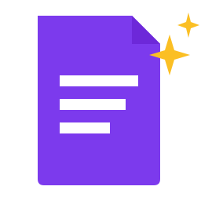

# README Pro



An agent skill that turns a repository into a clear, credible, and polished project README.

README Pro helps a coding agent inspect what the project actually does, choose a structure for its readers, show useful proof, and document a path to the first working result. It supports creating a README, improving an existing one, and reviewing one without edits.

[Install](#install) · [Use it](#use-it) · [Examples](examples/before-after.md) · [Skill instructions](skills/readme-pro/SKILL.md)

## What it brings to the page

- A specific explanation of the project and its value.
- Examples, screenshots, demos, or results that demonstrate real behavior.
- Setup and usage instructions checked against repository files and, when feasible, execution.
- Content priorities for applications, CLIs, libraries, APIs, AI/ML, data analysis, educational projects, and monorepos.
- Consistent formatting, useful navigation, accessible assets, and relevant badges.
- Honest limitations and a clear account of anything the agent could not verify.

The skill adapts the layout to the project and audience. It preserves useful existing content, attribution, and the project's voice. It never treats missing evidence as permission to invent a feature or result.

## Install

### Codex

Install the plugin from this repository's Codex marketplace:

```sh
codex plugin marketplace add eni-akin/readme_pro
codex plugin add readme-pro@eni-akin
```

Start a new Codex chat and ask it to use README Pro. Plugin registration and installation are tested with Codex CLI 0.159.0. No publisher account, API key, or server is required by the plugin. Codex itself requires its normal account and permissions.

README Pro is currently distributed through the GitHub-backed Codex marketplace only. Submission to the official OpenAI directory is **deferred** at the maintainer's request; README Pro is not listed or approved there. There is no scheduled directory submission. See the [release guide](docs/releasing.md).

### Manual skill installation

You can also clone this repository and copy the standalone skill. Current [Codex documentation](https://learn.chatgpt.com/docs/build-skills) lists `~/.agents/skills/` for user skills. From the repository root on macOS/Linux:

```sh
mkdir -p ~/.agents/skills
cp -R skills/readme-pro ~/.agents/skills/
```

The entry point should be `~/.agents/skills/readme-pro/SKILL.md`; retain the bundled references, UI metadata, and license. Preserve any existing local customizations before copying. Use either the plugin installation or the manual copy to avoid duplicate skill discovery. Codex detects skill changes automatically; restart it if needed.

### Other skill-capable agents

The core is plain Markdown with `name` and `description` frontmatter and relative reference files. Copy the whole `skills/readme-pro/` directory into the skill location documented by your agent. `agents/openai.yaml` supplies Codex-specific UI metadata. Other agents' discovery paths and invocation syntax vary; compatibility must be tested in the chosen agent.

No API key, external service, or runtime package is required by the skill itself. The target project's own setup may have additional requirements.

## Use it

In Codex:

```text
Use $readme-pro to create a README for this repository.
```

```text
Use $readme-pro to improve this README for developers evaluating the library.
Preserve our existing branding and contribution links.
```

```text
Use $readme-pro to review README.md without editing files.
Focus on setup accuracy and unsupported claims.
```

```text
Use $readme-pro to improve only the quick start. Leave the rest of the README as it is.
```

You can specify the reader, documentation language, tone, or files in scope. Otherwise the agent infers sensible choices from the repository. Codex can also select the skill automatically for matching README requests.

## What to expect

The agent inspects relevant source, manifests, examples, tests, documentation, and assets. It selects content for the project type, writes within your requested scope, then checks facts, commands, links, and presentation. Its handoff identifies changed files, verification results, and remaining gaps.

Some checks depend on the host environment. Without a renderer, browser, credentials, or required hardware, the agent should state that limitation. It should ask for an essential missing fact, omit an unsupported optional claim, or suggest a useful missing capture. A README request does not authorize publishing, changing repository settings, or altering application behavior.

## Package layout

```text
skills/readme-pro/
├── SKILL.md
├── LICENSE
├── agents/openai.yaml
└── references/
    ├── project-types.md
    ├── presentation.md
    └── verification.md
```

The entry point contains the workflow. References supply project-specific priorities, presentation decisions, and verification criteria. The repository also includes a portable plugin manifest, a Codex marketplace catalog, [brand assets](assets/README.md), and release tooling. No runtime scripts, external services, or visual templates are required by the skill.

## Development and contributions

See [the evaluation guide](docs/evaluation.md) for realistic acceptance cases. Improvements should address observed output problems, keep the entry point concise, and put conditional detail in the relevant reference. Include the request, minimal repository context, observed failure, and evidence that a proposed change fixes it. Remove secrets before sharing fixtures or outputs.

This repository contains the skill source; packaging does not itself establish that every agent or project has been tested. See [validation results](docs/validation.md) for the checks actually performed.

For release development, use Python 3.9 or newer and install the development-only YAML parser:

```sh
python3 -m pip install -r requirements-dev.txt
python3 -m unittest discover -s tests -v
python3 scripts/package_release.py
```

The last command validates metadata, builds a curated ZIP in `dist/`, checks an extracted copy, and writes a SHA-256 file. It refuses to overwrite an existing archive. The development dependency is not bundled in the plugin.

## Support and privacy

Use [GitHub Issues](https://github.com/eni-akin/readme_pro/issues) for sanitized questions or bug reports. Read the [privacy information](docs/privacy.md) and [terms](docs/terms.md). Do not post credentials or private repository content in public issues.

## Design references

The editorial direction draws on the [README research supplied by the author](https://chatgpt.com/share/6ae4f7ff-53bc-83e8-9a7d-798f5d06c1f0): help readers understand, evaluate, and try the project. The guidance is adapted into decisions rather than copied into a universal template. See [reference notes](docs/references.md) for further examples.

## License

[MIT](LICENSE) — copyright 2026 Eniola Akinpelumi.
